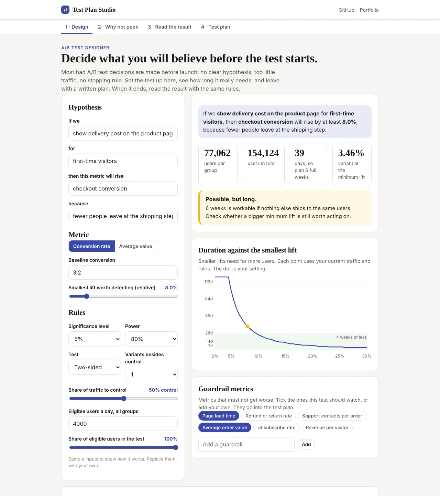

# Test Plan Studio

**Design, size and read A/B tests, with the decision rule written down before launch.**

**Current version:** 0.1.0

Live: https://kostasxeras.com/test-plan-studio/



## The question

Most bad A/B test decisions are made before the test starts. Teams launch without a clear hypothesis, without knowing whether they have enough traffic, and without a rule for when to stop. Then they check the dashboard every day and ship the first green number. I wanted one tool that covers the whole life of a test: the hypothesis, the sample size and duration, why early stopping is dangerous, a written plan, and a disciplined reading of the result.

## Who it is for

- Product managers planning an experiment who need to know if it is worth running
- Teams without a data scientist on hand who still want sound test design
- Interviewers and hiring managers checking how I think about experimentation

## What is inside

- **Hypothesis builder** that turns four fields into one testable sentence
- **Sample size and duration** for conversion rates or averages, with significance level, power, one or two sides, unequal splits, several variants (Bonferroni) and partial exposure
- **Duration curve** showing how many days each minimum lift needs at your traffic
- **Guardrail picker** with common guardrails and your own
- **Peeking simulator** that runs up to 2,000 A/A tests in the browser and shows how daily checking inflates false winners
- **Result reader** for conversions or averages: lift, p-value, confidence interval chart and a plain verdict
- **Trust checks**: sample ratio mismatch test, planned sample reached, fragile counts, implausible lifts
- **Test plan generator** that writes a Markdown pre-registration to copy or download

## Main findings

Full detail in the [case study](docs/case-study.md).

- **Checking daily and stopping at the first win multiplies false winners** (from the simulator, not real data). With the sample inputs (3.2% baseline, 2,000 users a group a day, 28 days, 5% significance), 1,000 A/A tests gave 4.4% false winners when read once at the end and 26.1% when stopped at the first significant day: about six times more. The exact numbers change with your inputs and the random seed. The direction does not.

## Data and sources

No real data. All numbers on the page are sample inputs and can be replaced. The sample size formulas were checked against SciPy: for a 3.2% baseline and an 8% relative lift at 5% significance and 80% power, both give 77,062 users per group, and 55,368 control users with a 30/70 split.

## Decisions

- [Fixed-horizon tests by default, with a peeking demo](docs/decisions/0001-fixed-horizon.md)
- [Round duration up to whole weeks](docs/decisions/0002-whole-weeks.md)
- [Bonferroni for several variants](docs/decisions/0003-bonferroni.md)
- [Sample ratio check before the verdict](docs/decisions/0004-srm-first.md)

## How I would measure success

No usage data yet. These are the measures I would track, with targets to set after real use.

| Measure | Definition | Target |
|---|---|---|
| Plans written | Plans copied or downloaded per visit | [target] |
| Tests resized | Share of visitors who change the minimum lift after seeing the duration | [target] |
| Results read | Share of visitors who use the result reader | [target] |

## What I would do next

1. Add a sequential test option with adjusted thresholds
2. Add a variance reduction estimate (CUPED) using pre-period data
3. Save plans in the browser and compare the plan with the result automatically

## How it was built

I framed the problem, made the product calls and wrote the conclusions. Claude (Anthropic) was my engineering partner for the code. 

## Run it yourself

One HTML page with no build step. Open `index.html` through any local web server, for example `python3 -m http.server`, then go to http://localhost:8000.

## Repo layout

```
index.html               The page
app.css                  Shared base styles
docs/product-brief.md    Problem, users, goals, scope
docs/case-study.md       Approach, decisions, findings, next steps
docs/decisions/          One record per real tradeoff
docs/screenshots/        Desktop and mobile
```
